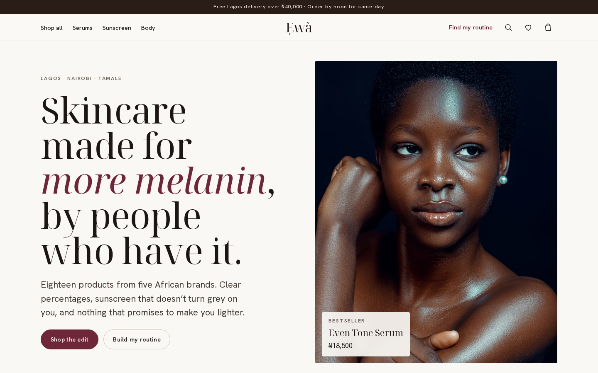
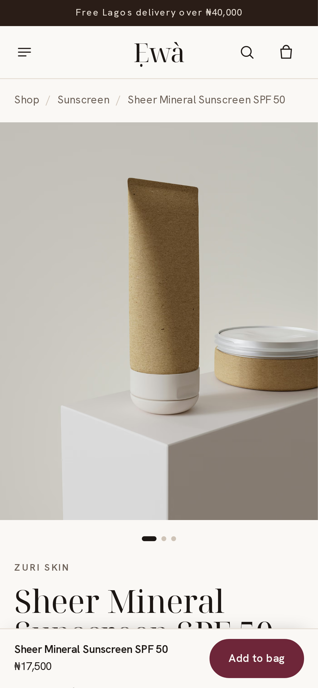
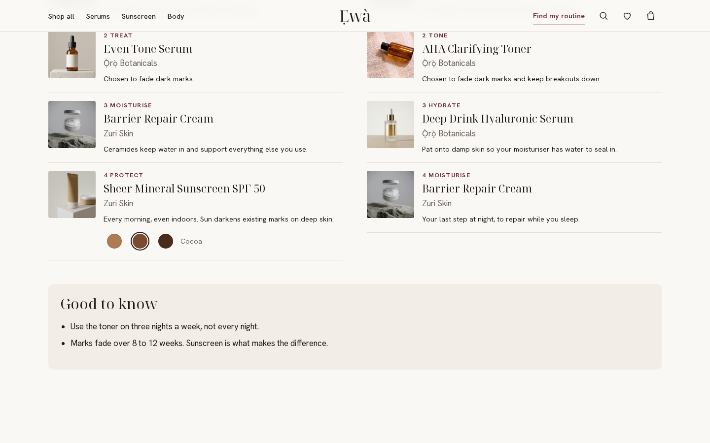
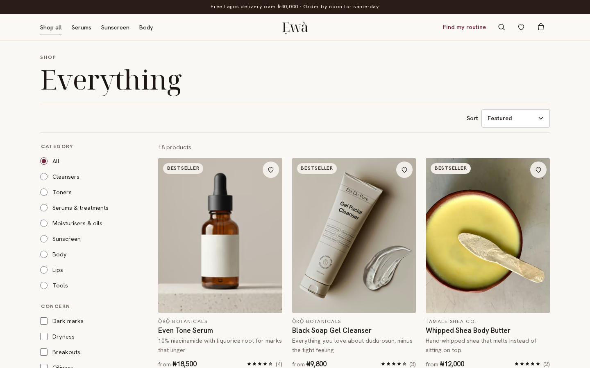
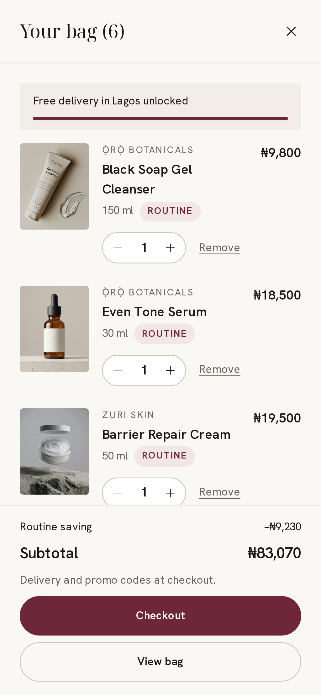
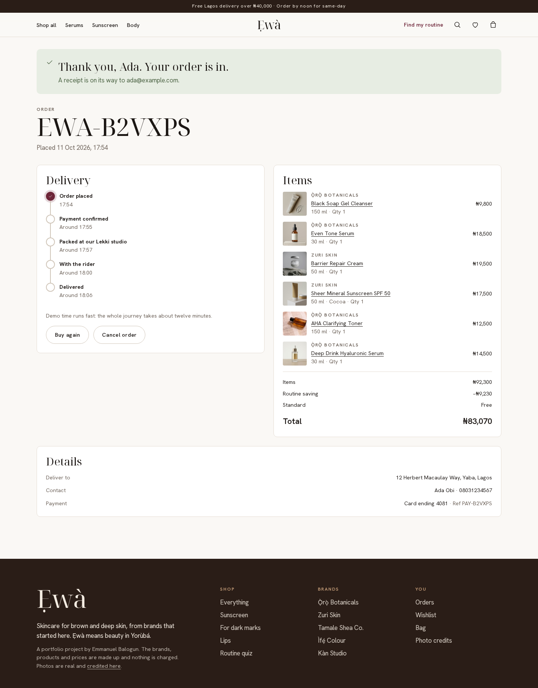

# Ẹwà

**Skincare for brown and deep skin, from brands that started here.** Ẹwà (Yorùbá for *beauty*) is a storefront for five African skincare and colour brands: browse eighteen products, find a routine with a short quiz, match a foundation-style shade, and check out with card, transfer or pay on delivery. Then watch the order move from packing to the rider.

It's a front-end project. The catalogue, pricing rules and payment gateway are mocks that live in this repo, so it clones and runs with no keys and no backend. The brands and products are made up; the photographs are real.

**Live:** _deploying…_

| Home (desktop) | Product (mobile) | Routine quiz (desktop) |
| --- | --- | --- |
|  |  |  |

| Shop with filters | Bag (mobile) | Order tracking |
| --- | --- | --- |
|  |  |  |

## What you can do

- **Shop** by category, concern (dark marks, breakouts, dryness…), skin type, brand, price and stock. Filters and sort live in the URL, so any view can be shared. On phones they move into a sheet that shows the result count before you apply.
- **Search** from anywhere with typeahead over names, brands, ingredients and concerns. Arrow keys and Enter work; results come from a real route handler (`/api/products`).
- **Product pages** have a swipeable gallery on phones, sizes with live stock ("only 4 left"), shade swatches, a sticky add-to-bag bar, ingredient and how-to-use sections, and reviews you can filter by skin type and add to yourself.
- **Find your shade.** Tinted products have a two-question matcher (depth and undertone) that ranks the shades and picks one for you.
- **Routine quiz.** Six questions build a morning and night routine with a reason for every step. It keeps strong actives out of reactive or pregnant routines, never stacks two at night, and adds notes like "start retinal twice a week". The result is encoded in the URL so it can be bookmarked or sent to a friend. Add it all at once and the routine gets 10% off.
- **Bag** as a drawer and a page: quantity steppers capped at stock, remove with undo, free-delivery progress, and "goes well with" suggestions.
- **Checkout** works out delivery from your state and the time of day (same-day Lagos only before noon), applies promo codes with their real conditions, and validates everything with errors announced and focus moved to the first problem. The server re-prices the bag from the catalogue and re-checks stock and promos, so a tampered cart can't change the price.
- **Orders** are kept on the device. Each one has a live timeline (demo time runs fast: about twelve minutes from placed to delivered), cancel while it's still being confirmed, and buy again.
- **Wishlist** that survives reloads.

### Promo codes and test cards

| Code | What it does |
| --- | --- |
| `EWA10` | 10% off orders over ₦20,000 |
| `FIRSTGLOW` | ₦3,000 off your first order over ₦15,000 |
| `FREESHIP` | Free delivery over ₦25,000 |
| `HARMATTAN` | 15% off moisturisers, oils and body care |
| `DETTY25` | Expired, to show the error |

| Card | Result |
| --- | --- |
| `4084 0840 8408 4081` | Approved |
| `4000 0000 0000 0002` | Declined |
| `5061 0000 0000 0000 007` (Verve) | Insufficient funds |

Any future expiry and any CVV. The payment section has one-tap buttons that fill these in.

### Installable and offline-friendly

Ẹwà is a PWA: web manifest with maskable and Apple icons and shortcuts to the bag and the quiz, and a hand-written service worker (`scripts/sw.template.js`, versioned per commit at build time). The shell and key pages are precached; pages you visit are cached network-first, static assets and photos cache-first. Offline, anything you've opened still works, your bag and wishlist are local anyway, and a page you've never seen shows a friendly offline screen. New deploys show an "Update" toast instead of swapping code mid-checkout.

## Stack

- **Next.js 16 App Router + React 19 + TypeScript** (strict). Cache Components and Partial Prerendering: product pages are prerendered with `generateStaticParams`, the shop streams its results, order pages stream the parts that depend on the URL.
- **Route handlers** for search (`/api/products`) and checkout (`/api/checkout`)
- **Zustand** with `persist` for bag, wishlist, orders and your reviews, plus a small `useHydrated` hook so persisted state never causes a hydration mismatch
- **CSS Modules** on tokens in `globals.css`. No UI kit: Noto Serif Display with Hanken Grotesk, a warm paper palette with plum, cocoa and sage.
- **Vitest + Testing Library** for unit tests, **Playwright + axe-core** for end-to-end and accessibility at 390px and 1440px
- **GitHub Actions** CI, **Vercel** hosting

## How it is put together

```
src/
  app/          routes: home, shop, shop/[slug], quiz, bag, checkout, orders, orders/[id], wishlist, credits, offline
  app/api/      products (search) and checkout (re-price, validate, pretend to charge)
  lib/          pure logic with tests: catalog, pricing, routine, shades, checkout, orders, payment, phone, money
  stores/       zustand stores: cart, wishlist, orders, reviews, ui
  data/         brands, products, reviews, photo metadata and credits
  components/   Photo, Dialog, BagDrawer, SearchPanel, ProductCard, Stars, QuantityStepper, Toaster…
scripts/        build-images (AVIF/WebP + blur placeholders), build-icons, build-sw
```

Some decisions:

- **Prices are never trusted from the client.** The bag stores slugs, variant ids and quantities only. `placeOrder()` (shared by the API route and the unit tests) prices everything again from the catalogue, checks stock, re-applies promo rules and refuses quantities the UI would never send.
- **The rules are plain functions.** Routine discounts, promo conditions, delivery windows, the quiz engine and shade ranking are all pure TypeScript in `src/lib`, tested without a browser.
- **Photos are prepared ahead of time.** `scripts/build-images.mjs` encodes each original to AVIF and WebP at several widths and records aspect ratio, dominant colour and a tiny blur placeholder. `<Photo>` uses a `<picture>` with those, so there is no layout shift and no runtime image service needed.
- **Time-sensitive UI waits for the browser.** Anything that reads the clock (same-day cut-off, order tracking) renders after hydration, so prerendered HTML never bakes in the build time.

### Accessibility

Native `<dialog>` for drawers, the search and the shade matcher, with focus returned to the trigger. Shades, sizes, delivery and payment are real radio groups. The search is a proper combobox. Checkout errors are linked to their fields with `aria-describedby`, the payment error is a focused alert, and focus moves to the first invalid field. Every main screen is checked with axe on a phone and a desktop in CI.

## Running it

Requires Node 22 (see `.nvmrc`).

```bash
npm install
npm run dev          # http://localhost:3000
npm test             # unit tests
npm run build && npm run e2e   # Playwright against the production build
npm run lint && npm run typecheck
```

`npm run images` regenerates `public/photos` from the originals in `photos/originals` (not committed because of their size; `photos/photos.json` lists every source).

## Photo credits

All photographs are from [Unsplash](https://unsplash.com) and used under the [Unsplash License](https://unsplash.com/license). Each photographer is credited by name with a link on the [/credits](src/app/credits/page.tsx) page in the app, built from `src/data/photo-credits.json`. The people and packaging pictured have no connection to the fictional brands.

## License

Code is MIT, see [LICENSE](LICENSE). Photos remain under the Unsplash License.
